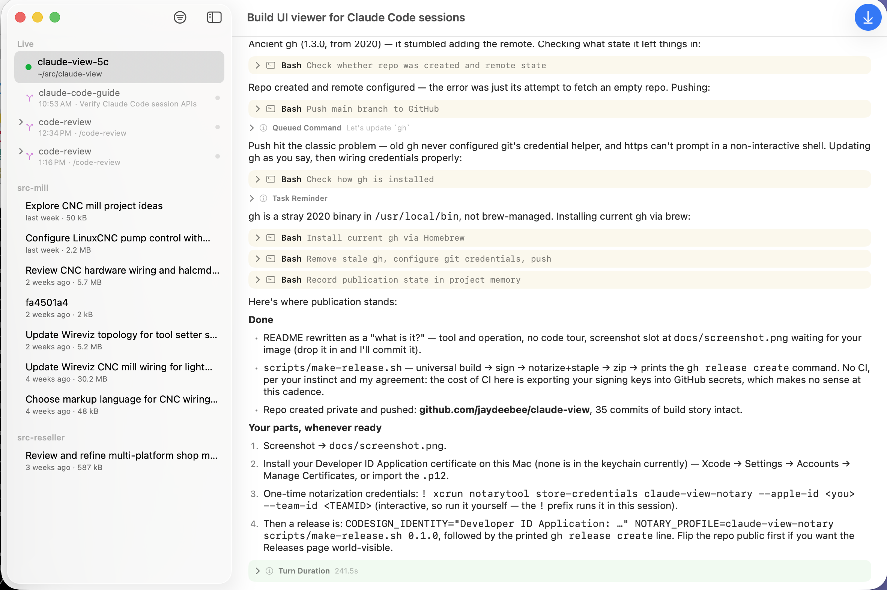

# Claude View

A native macOS viewer for [Claude Code](https://code.claude.com) sessions.



Claude Code's terminal UI is where you work — but terminal backlog is
fragile, and busy sessions scroll fast. Claude View is the companion
window: it renders your sessions live as they progress, keeps history
reviewable and skimmable, and never asks for input. The terminal stays
in charge; the viewer keeps the record legible.

## What it shows

- **Every session on the machine**, live ones first. Running sessions
  show their status (working, idle, or whatever the harness reports);
  finished ones stay browsable per project, titled and timestamped.
- **Agents as a tree.** Task agents and background skills like
  `/code-review` appear nested under their session in the sidebar, each
  with its own running/idle/done indicator — expand a review to watch
  its finder agents individually, or click any agent to open its stream
  full-pane. Launch points inside a transcript link to the same place.
- **Turns that fold.** Each prompt heads the turn it elicited: recent
  turns render in full, older ones collapse to the question plus step
  count and duration. Inside a turn, tool calls show what they're doing
  on one line and expand to inputs and results; whatever is currently
  running stays open on its own.
- **Prose as prose.** Markdown renders properly — fenced code, tables,
  lists — with a quiet color language behind it: blue for your prompts,
  mustard for tool work, green for a turn's end.
- **The truth, on demand.** Every row can be flipped over to the raw
  transcript entry — syntax-colored, value-aligned JSON, faithful to
  the bytes (exact integers, escaped control characters). When Claude
  Code's internal format shifts, unknown entries render as raw JSON
  instead of breaking.

## How it works

Claude Code writes session data under `~/.claude`: a registry of
running sessions and an append-only JSONL transcript per session, with
agent transcripts alongside. Claude View watches those files with
FSEvents and tails them incrementally — that's the whole trick.

It is strictly read-only: no hooks installed, nothing modified, and —
with one disclosed exception — no network. The exception: once a day,
and whenever you ask via the app menu, it asks GitHub whether a newer
release exists. Version strings travel; nothing else does. The
automatic check is the app's one setting, toggled in the same menu.
If Claude Code isn't installed, there is simply nothing to show.

## Running it

Grab the app from [Releases](../../releases), or build from source:

```sh
swift run ClaudeView     # development
scripts/make-app.sh      # dist/Claude View.app
swift test               # unit tests
```

Requires macOS 15+ and a current Xcode toolchain. No dependencies.

`CLAUDE_VIEW_REAL_DATA=1 swift test` additionally parses and assembles
every transcript in your real `~/.claude` — useful after a Claude Code
update to catch format drift early.

## Releasing (maintainers)

```sh
scripts/make-release.sh 0.2.0
```

Builds a universal binary, wraps and signs the app
(`CODESIGN_IDENTITY="Developer ID Application: ..."`), notarizes and
staples if `NOTARY_PROFILE` names a `notarytool` keychain profile, and
zips the result into `dist/` with the `gh release` command printed at
the end.

## License

MIT — see [LICENSE](LICENSE).
